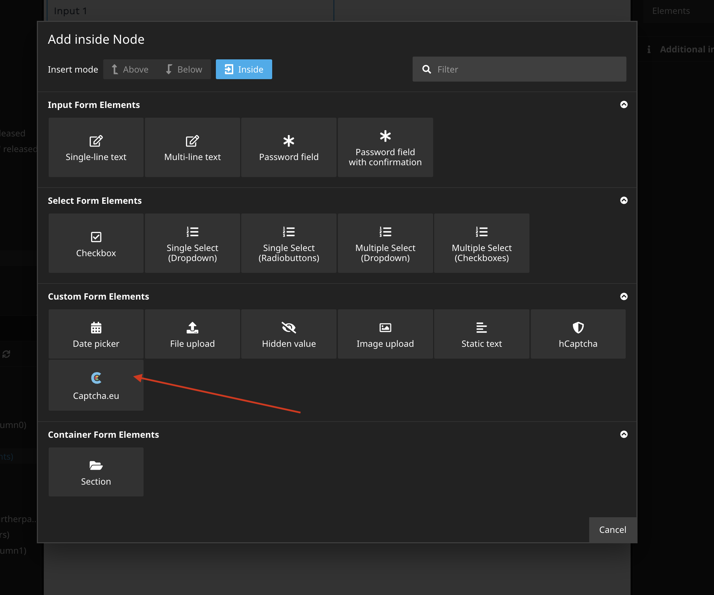

# Captcha.eu integration for Neos Form Framework

[Official CAPTCHA.eu documentation](https://docs.captcha.eu/neos-install?id=captchaeu-integration-for-neos-form-framework)

## Installation

Install the package via Composer:

```bash
$ composer require captcha-eu/neos
```

## Configuration
Add your Public Key (`publicKey`) and Rest Key (`restKey`) from you Captcha.eu account. 

The integration supports two modes:

- `invisible`: The CAPTCHA verification runs without displaying a visible CAPTCHA widget.
- `widget`: Displays the CAPTCHA.eu Widget directly in the form.

You can also configure the widget theme.

Add the following configuration to your Neos settings:

```yaml
CaptchaEU:
  CaptchaEU:
    publicKey: 'your-public-key'
    restKey: 'your-rest-key'
    mode: 'invisible' # invisible | widget
    theme: 'light'    # light | dark | auto
```

### Mode Configuration

**Invisible Mode (default)**

```yaml
mode: 'invisible'
```

Uses the invisible CAPTCHA verification flow without displaying the interactive widget.

**Widget Mode**

```yaml
mode: 'widget'
theme: 'light'
```

Displays the interactive CAPTCHA.eu Widget inside the form.

Available themes:

| Theme | Description |
|---|---|
| `light` | Light widget appearance |
| `dark` | Dark widget appearance |
| `auto` | Automatically adapts to the user's system theme |

In production environments, we strongly recommend using environment variables to configure your Public Key and REST Key instead of storing credentials directly in configuration files.

## Add form element with Neos.Form.Builder

1. Open the Neos backend.
2. Create a new form or edit an existing form using Neos Form Builder.
3. Add the **CAPTCHA.eu** form element to your form.
4. Save and publish the form.



The CAPTCHA.eu form element can be used with both Invisible Mode and Widget Mode.


**Important:** The CAPTCHA form element must remain part of the form definition. Global configuration alone does not automatically add CAPTCHA verification to every form.

## Usage with   [Neos.Form](https://github.com/neos/form)

You can also add the CAPTCHA form element directly to a Neos.Form definition.

Add the following element to your form's renderables:

```yaml
type: 'Neos.Form:Form'
identifier: someIdentifier
label: Label
renderables:
  -
    type: 'Neos.Form:Page'
    identifier: page-one
    renderables:
      -
        type: 'CaptchaEU.CaptchaEU:Captcha'
        identifier: captcha
        label: Captcha
        properties:
          publicKey: your-public-key
          restKey: your-private-key
finishers:
  -
   <Your finishers here>
```


## Override Settings

You can override the following configurations in the node properties:

* Public Key
* Rest Key

The default mode and theme can be configured globally:

- `CaptchaEU.CaptchaEU.mode`
- `CaptchaEU.CaptchaEU.theme`

