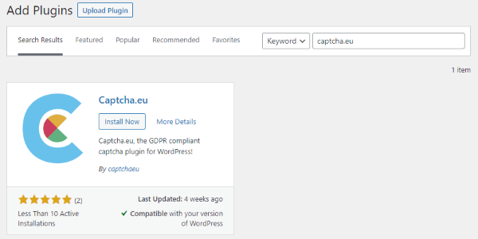
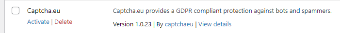
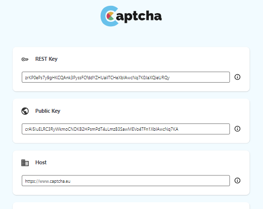
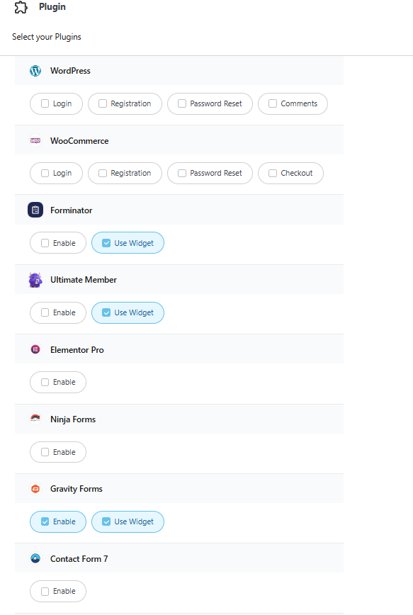
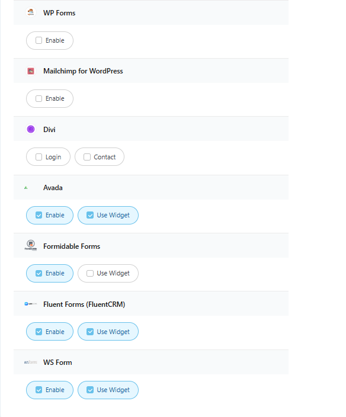
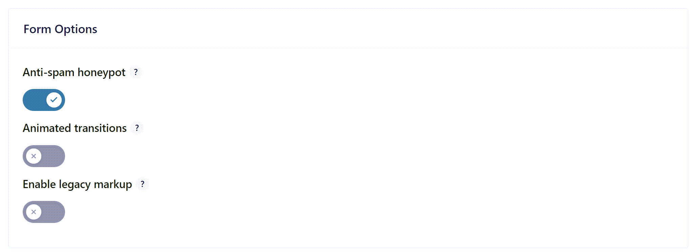
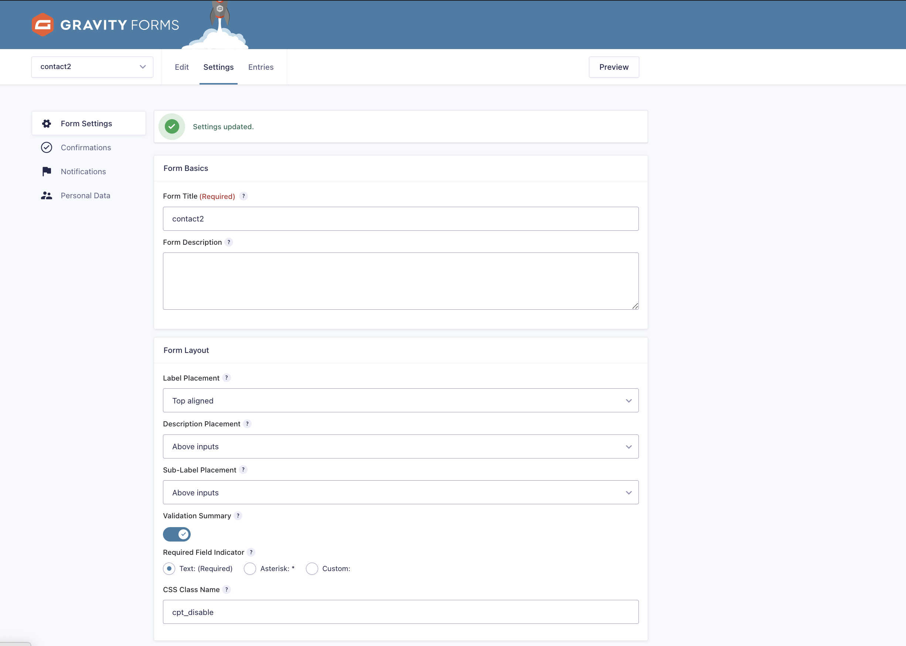

# WordPress Integration

The captcha.eu WordPress plugin provides seamless bot protection for your WordPress website with zero configuration complexity.

## Installation Guide

### Step 1: Install the Plugin
Search for "captcha.eu" in the WordPress plugin directory and install it directly from your WordPress admin panel.

### Step 2: Create Your Account
If you haven't already, [sign up for a captcha.eu account](https://www.captcha.eu/login). New accounts include 100 free verification requests for testing.

### Step 3: Set Up Domains
In your captcha.eu dashboard, create a domain entry for your WordPress site. **Important**: Enter your actual website domain (e.g., `example.com`) as this must match where your forms are hosted for security purposes.

### Step 4: Activate the Plugin
Go to **Plugins** in your WordPress admin and activate the captcha.eu plugin.

### Step 5: Configure API Keys
Navigate to the plugin settings and enter your API keys from the captcha.eu dashboard:
- **Public Key**: Used for client-side integration
- **REST Key**: Used for server-side validation (keep this secret!)

### Step 6: Enable Protection
Select which forms and plugins you want to protect by checking the appropriate boxes. This activates bot protection for your chosen components.

## Success! Your WordPress Site is Protected

Your WordPress website is now protected against bots. The plugin will automatically validate all form submissions and block suspicious traffic.

## Testing Your Integration

To verify everything is working:
1. Visit a protected form on your site
2. Check your captcha.eu dashboard for incoming requests
3. Review our [testing guide](testing.md) for comprehensive validation

## Need Help?

- **Plugin Issues**: Check the WordPress admin for error messages
- **API Problems**: Verify your keys in the dashboard
- **General Support**: [Contact our team](https://www.captcha.eu/contact) or use live chat

## Plugin Integrations

### Avada Forms

captcha.eu integrates natively with forms created using [Avada Form Builder](https://avada.com/feature/form-builder/).

The integration provides a dedicated **Captcha.eu** form element. You can add this element to individual Avada forms and configure the protection mode, widget theme, and language.

Unlike the legacy Avada integration, protection is not automatically added to every Avada form. Each form you want to protect must contain the Captcha.eu element.

#### Configure Global Avada Settings

1. Make sure Avada and the captcha.eu WordPress plugin are installed and active.
2. In your WordPress admin panel, go to **Avada → Options → Forms**.
3. Find the **captcha.eu** section.
4. Enable captcha.eu.
5. Configure the following settings:

| Setting | Description |
|---|---|
| **Enable captcha.eu** | Enables captcha.eu protection for Avada Form Builder. |
| **Public Key** | Your captcha.eu Public Key, used for the frontend integration. |
| **REST Key / Secret Key** | Your captcha.eu REST Key, used for server-side validation. Keep it secret! |
| **Protection Mode** | Sets the default protection mode: Visible Widget or Invisible. |
| **Language** | Sets the default widget language: English or Deutsch. |
| **Widget Theme** | Sets the default widget appearance: Auto, Light, or Dark. |
| **Validation Failure Message** | Defines the message displayed when captcha.eu validation fails. |

6. Save your Avada options.

#### Add the Captcha.eu Element to an Avada Form

1. Open the page containing your Avada form in the Avada Builder.
2. Edit the form using Avada Form Builder.
3. Add the **Captcha.eu** element to your form.
4. Configure the element settings:

**Protection Mode**

- **Global Default:** Uses the protection mode configured in Avada global options.
- **Widget:** Displays a visible captcha.eu widget on the form.
- **Invisible:** Validates the visitor in the background without displaying a visible widget.

**Widget Theme**

- **Global Default:** Uses the theme configured in Avada global options.
- **Auto:** Automatically selects the widget appearance.
- **Light:** Uses the light theme.
- **Dark:** Uses the dark theme.

**Language**

- **Global Default:** Uses the language configured in Avada global options.
- **English:** Displays the widget in English.
- **Deutsch:** Displays the widget in German.

5. Save the form and update the page.

#### Protection Modes

**Widget Mode**

The visible captcha.eu widget is displayed directly inside the form. The submit button remains disabled until the visitor successfully completes the CAPTCHA.

**Invisible Mode**

No visible CAPTCHA widget is displayed. captcha.eu obtains a solution in the background before the form submission is processed.

#### Troubleshooting

- **Captcha.eu element is not available:** Make sure Avada Form Builder and the captcha.eu plugin are active.
- **Captcha.eu is not enabled:** Check **Avada → Options → Forms** and make sure captcha.eu is enabled.
- **The element displays a configuration message:** Verify that captcha.eu is enabled and that a valid Public Key is configured.
- **Form submissions fail:** Verify the Public Key, REST Key, and configured domain in your captcha.eu and Avada settings.
- **Widget does not appear:** Check that the element's protection mode is set to Widget or that the global default is configured to use Widget mode.
- **Changes are not reflected:** Clear WordPress page caches, JavaScript optimization caches, and CDN caches before testing again.

### WordFence Login Security

WordFence Login Security support is available in early access. Contact us for integration:
- **Email**: hello@captcha.eu
- **Support**: [Contact form](https://www.captcha.eu/contact)
- **Live Chat**: Available on our website

### Gravity Forms

**Important Configuration Required**

Gravity Forms' honeypot feature conflicts with captcha.eu. You must disable it for proper operation:

**Excluding Specific Forms**

To disable protection on specific forms, add the CSS class `cpt_disable` to the form:

### Avada

captcha.eu supports forms created with the **Avada Form Builder**.

Two modes are available:

**Enable** – Automatically intercepts form submission and validates the captcha in the background. No visible widget is shown to the user.

**Use Widget** – Displays the "Ich bin ein Mensch" widget directly on the form. The submit button remains disabled until the user completes the captcha check.

To enable protection, go to the captcha.eu plugin settings and check **Enable** and/or **Use Widget** under the Avada section.

